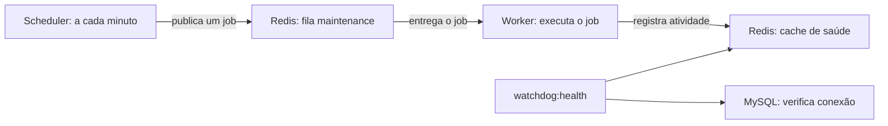

# Crypto Listing Watchdog — base local

Laravel 13, PHP 8.4, MySQL 8.4 e Redis 7.4, com processos separados para HTTP, agendamento e filas. Esta entrega prepara a infraestrutura e configura Ravencoin (RVN). A coleta nas exchanges, o histórico de ativos, a outbox e os alertas ainda serão implementados.

## Primeiro uso

Requisitos no host: Docker Engine, Docker Compose v2 e PHP CLI para gerar `.env`. O Composer usado na instalação vem na imagem; não precisa instalar Redis/MySQL no host.

```sh
cd /var/www/html/crawler-token
./bin/setup
```

O script cria `.env` com chave Laravel e senhas aleatórias, preserva um `.env` existente, constrói a imagem, instala as versões de `composer.lock`, executa migrations e aguarda os serviços ficarem saudáveis. A primeira construção baixa pacotes; aguarde. O scheduler pode precisar de até um minuto para executar a primeira tarefa.

O ambiente é **testing**, com banco exclusivo `crawler_token_test` no serviço `mysql_test:3306`. Esses valores ficam fixos no Compose e são verificados pela aplicação antes de acessar o banco. Não executar Artisan diretamente no host. A aplicação usa o servidor de desenvolvimento do PHP; esta configuração não é uma implantação de produção.

Verificação HTTP: <http://127.0.0.1:18080/health>. A porta fica disponível apenas nesta máquina. Não há interface visual nesta fase. MySQL e Redis não publicam portas no host.

## O que cada ferramenta faz

| Ferramenta/processo | Função neste projeto |
| --- | --- |
| PHP + Laravel | Executam a aplicação e oferecem comandos, jobs, configuração, migrations e integração com os serviços. |
| Composer | Instala as bibliotecas PHP nas versões registradas em `composer.lock`. |
| Docker Compose | Cria a rede, volumes e containers; inicia os serviços na ordem necessária e acompanha sua saúde. |
| MySQL | Armazena dados duráveis. Por enquanto recebe as tabelas padrão de jobs/lotes/falhas; as tabelas do monitor serão adicionadas depois. |
| Redis | Guarda tarefas pendentes da fila e dados temporários de cache, inclusive os registros de atividade. |
| Scheduler | Confere os horários definidos em `routes/console.php` e envia as tarefas programadas para execução. |
| Worker | Retira tarefas da fila Redis e executa o código de cada job. |
| PHPUnit / Pint | Verificam comportamentos e padronizam a formatação PHP durante o desenvolvimento. |

Scheduler e worker são comandos do próprio Laravel rodando continuamente em containers separados, com o mesmo código da aplicação. Não precisam de instalação de cron ou Supervisor neste ambiente.



Hoje o job somente registra atividade: serve para verificar toda a passagem pela fila. Quando houver coleta, o scheduler poderá agendar uma consulta e o worker buscar os dados. Cada etapa continuará independente: ter Redis funcionando não comprova que o worker está processando tarefas.

### Redis: fila e cache

- O banco lógico **0** recebe a fila; o **1**, o cache. São divisões do mesmo Redis e compartilham memória.
- O volume `redis_data` e o AOF com sincronização a cada segundo preservam dados em reinícios normais. Uma falha abrupta pode perder aproximadamente o último segundo de gravações; isso não substitui a futura outbox no MySQL.
- O limite é **128 MB**, com política `noeviction`: ao esgotar a memória, gravações falham em vez de remover tarefas silenciosamente. É uma capacidade inicial; acompanhar antes de aumentar a carga.
- Redis está sem senha nesta base local e acessível pela rede Docker do projeto. Não publicar sua porta; uma implantação remota precisa de configuração própria.
- Não usar `FLUSHALL`: apagaria filas e cache. Alterar `docker/redis/redis.conf` exige reiniciar o Redis.

Na validação local, Redis informou que `vm.overcommit_memory` está desabilitado no host. Os testes funcionaram, mas essa configuração pode prejudicar gravações em segundo plano sob pressão de memória. O parâmetro do host foi preservado porque é compartilhado com outros projetos; revisar antes de uma implantação de produção.

### Scheduler: quando fazer

`php artisan schedule:work --env=testing` mantém o agendador ativo. Em `routes/console.php`, a tarefa de saúde roda **a cada minuto**, envia um job para `maintenance` e registra que houve agendamento. `withoutOverlapping` protege a execução do agendamento; não garante exclusividade de futuros jobs de coleta.

Só mantenha uma instância de scheduler nesta base. Se ele parar, novos jobs programados deixam de entrar na fila. Os jobs já enfileirados continuam disponíveis para o worker.

### Worker: executar o trabalho

O serviço usa `queue:work redis` e atende `maintenance` e `default`, nessa ordem. Configuração inicial:

| Opção | Valor | Efeito |
| --- | --- | --- |
| `--tries` | 3 | Até três tentativas para jobs que falharem. |
| `--backoff` | 10 s | Espera entre novas tentativas após exceções. |
| `--timeout` | 60 s | Limite de execução por job; excedê-lo encerra o processo. |
| `retry_after` | 120 s | Após uma reserva expirar, o Redis pode entregar novamente o job. Fica acima do timeout. |
| `--memory` | 192 MB | Após um job, o worker pode encerrar se ultrapassar esse limite. |
| `--max-time` | 3600 s | Recicla o processo periodicamente; o Docker o inicia novamente. |

PHP tem limite de memória de 256 MB e o container aguarda até 90 s para uma parada normal. Jobs futuros precisam ser idempotentes: uma tarefa pode ser entregue novamente após falhas. A tabela `failed_jobs` permite consultar jobs que esgotaram as tentativas. As tabelas padrão `jobs` e `job_batches` também são criadas, mas a fila ativa desta base usa Redis.

`restart: unless-stopped` reinicia processos encerrados; um container apenas marcado como `unhealthy` não é reiniciado automaticamente pelo Compose. Investigue os logs quando a saúde falhar.

## Comandos do dia a dia

Sempre executar na pasta do projeto:

```sh
# Situação dos cinco serviços
docker compose ps

# Verificação completa: banco, Redis e atividade nos últimos 180 segundos
docker compose exec -T app php artisan watchdog:health --env=testing

# Agenda e falhas de processamento
docker compose exec -T app php artisan schedule:list --env=testing
docker compose exec -T app php artisan queue:failed --env=testing

# Acompanhar execução (Ctrl+C sai dos logs, sem parar os serviços)
docker compose logs -f --tail=50 scheduler worker

# Testes, com o MySQL de testes ativo
docker compose exec -T app php artisan test --env=testing

# Parar e voltar depois, preservando containers/volumes
docker compose stop
docker compose up -d --wait --wait-timeout 150
```

`/health` verifica o boot HTTP; a checagem CLI verifica também infraestrutura e heartbeat. Um registro ausente, futuro ou com mais de 180 segundos faz a checagem CLI falhar. Esse heartbeat comprova o processamento da tarefa de manutenção, não a atualização de dados de exchanges.

Após alterar código PHP ou `config/watchdog.php`, reinicie os processos duradouros:

```sh
docker compose restart app scheduler worker
```

Após editar `.env`, recrie os containers para recarregar as variáveis:

```sh
docker compose up -d --force-recreate --wait --wait-timeout 150 app scheduler worker
```

Não troque senhas MySQL apenas no `.env` depois da inicialização: as variáveis da imagem criam os usuários somente no primeiro uso do volume. A mudança posterior precisa ser feita também no banco. Preserve `.env` e os volumes; não remova volumes para resolver erros de configuração.

## Ativos

`config/watchdog.php` concentra identidade, aliases, exchanges, produtos e símbolos. RVN vem habilitado; `WATCHDOG_RVN_ENABLED=false` o desabilita na configuração. O heartbeat continua ativo porque verifica infraestrutura. Nenhum coletor consome essa configuração ainda.

| Exchange | Spot | Perpétuo |
| --- | --- | --- |
| Binance | `RVNUSDT` | `RVNUSDT` |
| MEXC | `RVNUSDT` | `RVN_USDT` |

Os símbolos são candidatos para consulta; não significam confirmação de mercado atualmente ativo. Novos ativos serão adicionados como novas entradas, mantendo identidade e aliases próprios. A implementação futura deverá validar disponibilidade separadamente por exchange/produto/rede, conforme `crawler-rvn.md`.

## Referências oficiais

- [Instalação Laravel](https://laravel.com/docs/13.x/installation)
- [Filas e workers](https://laravel.com/docs/13.x/queues)
- [Agendamento](https://laravel.com/docs/13.x/scheduling)
- [Laravel com Redis](https://laravel.com/docs/13.x/redis)
- [Ordem de inicialização do Compose](https://docs.docker.com/compose/how-tos/startup-order/)
- [Persistência Redis](https://redis.io/docs/latest/operate/oss_and_stack/management/persistence/)
